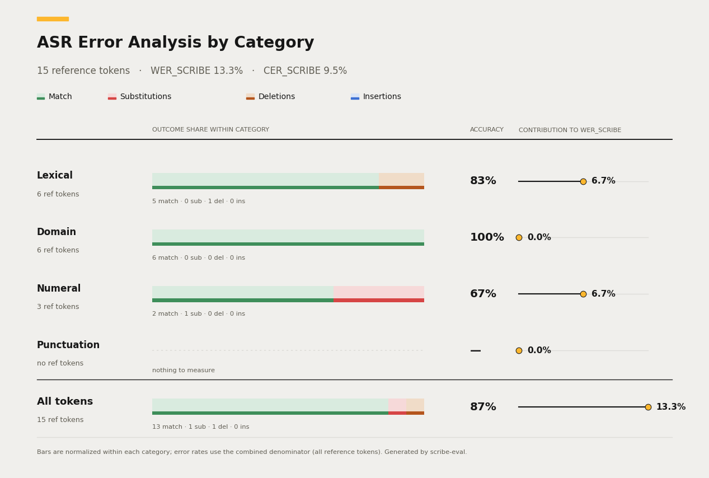

# SCRIBE — Diagnostic Evaluation for Indic & Domain-Specific ASR

[](https://www.python.org/downloads/)
[](https://github.com/adalat-ai-tech/scribe-eval/blob/main/LICENSE)
[](https://doi.org/10.5281/zenodo.20765419)

`scribe-eval` is the open-source evaluation framework introduced in the SCRIBE
paper (*Diagnostic Evaluation and Rich Transcription Models for Indic ASR*,
[Interspeech 2026](https://doi.org/10.21437/Interspeech.2026-3436)). It provides fine-grained error metrics for
ASR systems on Indic languages (Malayalam, Kannada, Hindi, ...) and on
domain-specific transcription (legal, medical, technical).

Token categories are decomposed into base classes (LEXICAL, NUMERAL, PUNCT) and
optional domain classes (LEGAL, MEDICAL, TECH, or custom). Domain-critical
terminology is shielded from incorrect splitting and tracked separately — so a
single misrecognized legal term doesn't inflate your general lexical
error rate (ER_LEX).

**Try it in the browser:** <https://adalat-ai-tech.github.io/scribe-eval/>

## Installation

```bash
pip install scribe-eval
```

This installs the library and the `scribe-batch` command. For the
interactive web UI, add the visualizer extra:

```bash
pip install 'scribe-eval[visualizer]'
```

To work on SCRIBE itself, install from source instead:

```bash
git clone https://github.com/adalat-ai-tech/scribe-eval.git
cd scribe-eval
uv sync --all-extras    # or: pip install -e '.[all]'
```

Tests, lint and layout are described in
[docs/development.md](https://github.com/adalat-ai-tech/scribe-eval/blob/main/docs/development.md).

## Quick Start

Evaluate a JSONL file of predictions (one record per line with a `text`
reference and a `pred_text` hypothesis):

```bash
scribe-batch --input predictions.jsonl --output-dir results --analysis --chart
```

Or score a single pair in Python:

```python
from scribe import compute_cer_scribe, text_error_rates, DomainConfig

ref = "charged u/s 302 IPC on 22.05.2023"
hyp = "charged u/s 303 IPC on 22.05.2023"

report = text_error_rates(ref, hyp, DomainConfig.legal())

print(f"ER_LEX: {report['LEXICAL']['error_rate']:.2%}")
print(f"ER_DOMAIN: {report['LEGAL']['error_rate']:.2%}")
print(f"ER_NUM: {report['NUMERAL']['error_rate']:.2%}")

cer = compute_cer_scribe(ref, hyp, DomainConfig.legal())
print(f"CER_SCRIBE: {cer['cer_scribe']:.2%}")
```

### What you get

For this three-record `predictions.jsonl`:

```jsonl
{"text": "charged u/s 302 IPC on 22.05.2023", "pred_text": "charged u/s 303 IPC on 22-05-2023", "source_dataset": "legal-dictation"}
{"text": "witness PW1 deposed before the court", "pred_text": "witness PW 1 deposed before court", "source_dataset": "legal-dictation"}
{"text": "എനിക്ക് അറിയാം", "pred_text": "എനിക്കറിയാം", "source_dataset": "malayalam-read"}
```

`scribe-batch` prints the aggregate table and saves it to
`results/summary_report.txt`, one row overall and one per group
(`source_dataset` by default, any field with `--group-by`):

```
GROUP                     |     ER_LEX |  ER_DOMAIN |     ER_NUM |   ER_PUNCT | WER_SCRIBE | CER_SCRIBE | SANDHI
OVERALL                   |      6.67% |      0.00% |      6.67% |        N/A |     13.33% |      9.52% |      1
legal-dictation           |      7.69% |      0.00% |      7.69% |        N/A |     15.38% |      7.14% |      0
malayalam-read            |      0.00% |        N/A |        N/A |        N/A |      0.00% |     21.43% |      1
```

`N/A` means the category had nothing to measure. The SANDHI column counts
merged or split compounds that were scored as matches, not errors.

With `--analysis --chart` it also writes `analysis_report.txt` (accuracy,
WER_SCRIBE, per-category breakdown and every frequent substitution, deletion
and insertion), `evaluation-detailed.jsonl` (every record with its scores) and
`category_breakdown.png`:



Each row shows how many reference tokens in that category were matched,
substituted, deleted or inserted, the accuracy, and the category's share of
the overall WER_SCRIBE.

`scribe-batch --help` lists every flag with its default; other field names,
`--no-sandhi`, `--group-by`, domains and workers are covered with the Python
API in
[docs/batch-processing.md](https://github.com/adalat-ai-tech/scribe-eval/blob/main/docs/batch-processing.md).

## Features

- **Domain-aware tokenization** — shield domain terms from punctuation splitting; track errors separately
- **Sandhi correction detection** — identifies merged/split words common in Indic ASR
- **Normalized error rates** — combined denominator prevents misleading metrics for sparse categories
- **CER_SCRIBE** — character error rate on normalized token streams; format variants cost nothing, and it needs no sandhi machinery to be robust to agglutination
- **`scribe-batch` CLI** — one command from JSONL to summary table, per-sample JSONL, full error analysis and chart, with a run-info line that makes the run reproducible
- **Batch evaluation API** — evaluate in-memory records (`evaluate_records`) or JSONL files with per-sample detail and per-group aggregation
- **Interactive visualizer** — Streamlit UI with color-coded alignment, WER_SCRIBE/CER_SCRIBE/Accuracy metric tiles, category breakdown chart, frequent-error tables, and per-sample drill-down

## Token Categories

| Category | Type | Label | Description |
|---|---|---|---|
| LEXICAL | base | ER_LEX | General words (Indic and English) |
| NUMERAL | base | ER_NUM | Numbers, dates, times (302, 22.05.2023, 10:30) |
| PUNCT | base | ER_PUNCT | Punctuation marks |
| LEGAL / MEDICAL / TECH / custom | domain | ER_DOMAIN | Domain terminology — bundled or your own |

One domain is active per evaluation: pass a single `DomainConfig`
(a bundled factory like `DomainConfig.legal()` or your own file via
`DomainConfig.from_file`); its error rate always reports as **ER_DOMAIN**.
See [docs/domain-configuration.md](https://github.com/adalat-ai-tech/scribe-eval/blob/main/docs/domain-configuration.md).

## Sandhi Awareness

Agglutination makes word boundaries unstable in Indic text: the same
speech can be written as one word or two. SCRIBE detects such two-word
merges and splits at alignment time and scores them as matches instead
of errors.

Examples in Malayalam, Kannada and Hindi, and the measured effect on
WER_SCRIBE, are in
[docs/architecture.md](https://github.com/adalat-ai-tech/scribe-eval/blob/main/docs/architecture.md#sandhi-examples-from-evaluation-data).
Detection is an orthographic heuristic, not a linguistic analysis — it
is deliberately lenient and admits some false positives. See
[Sandhi detection: scope and limitations](https://github.com/adalat-ai-tech/scribe-eval/blob/main/docs/architecture.md#sandhi-detection-scope-and-limitations)
before relying on sandhi counts.

## Domain Configuration

Factory methods for bundled domains: `DomainConfig.legal()`, `DomainConfig.medical()`, `DomainConfig.technical()`

File-based and custom inline configs are also supported. See [docs/domain-configuration.md](https://github.com/adalat-ai-tech/scribe-eval/blob/main/docs/domain-configuration.md).

## Examples and Docs

Short runnable scripts for alignment display, single-sample reports and
domain configs live in the repository's
[`examples/`](https://github.com/adalat-ai-tech/scribe-eval/tree/main/examples) directory (not installed with the package).
[`docs/`](https://github.com/adalat-ai-tech/scribe-eval/tree/main/docs) covers the
[batch workflow](https://github.com/adalat-ai-tech/scribe-eval/blob/main/docs/batch-processing.md),
[domain configuration](https://github.com/adalat-ai-tech/scribe-eval/blob/main/docs/domain-configuration.md),
the [visualizer](https://github.com/adalat-ai-tech/scribe-eval/blob/main/docs/visualizer.md),
[development](https://github.com/adalat-ai-tech/scribe-eval/blob/main/docs/development.md) and the
[architecture and glossary](https://github.com/adalat-ai-tech/scribe-eval/blob/main/docs/architecture.md).

## Interactive Visualizer

```bash
scribe-visualizer    # requires the [visualizer] extra (see Installation)
```

A hosted demo runs at <https://adalat-ai-tech.github.io/scribe-eval/>.
See [docs/visualizer.md](https://github.com/adalat-ai-tech/scribe-eval/blob/main/docs/visualizer.md).

## Citation

The SCRIBE paper was presented at Interspeech 2026 and is published in the
ISCA Archive: <https://doi.org/10.21437/Interspeech.2026-3436>
(preprint: <https://arxiv.org/abs/2605.20712>).

```bibtex
@inproceedings{manohar26_interspeech,
  title     = {{SCRIBE: Diagnostic Evaluation and Rich Transcription Models for Indic ASR}},
  author    = {Kavya Manohar and Arghya Bhattacharya and Kush Juvekar and Kumarmanas Nethil},
  year      = {2026},
  booktitle = {{Interspeech 2026}},
  pages     = {4773--4778},
  doi       = {10.21437/Interspeech.2026-3436},
  issn      = {2958-1796},
}
```

To cite the software itself, use the "Cite this repository" button on GitHub
(see [CITATION.cff](https://github.com/adalat-ai-tech/scribe-eval/blob/main/CITATION.cff)) or the Zenodo DOI:
[10.5281/zenodo.20765419](https://doi.org/10.5281/zenodo.20765419).

## License

Licensed under the [Apache License 2.0](https://github.com/adalat-ai-tech/scribe-eval/blob/main/LICENSE).

## Acknowledgements

Developed as part of the [Adalat AI](https://adalat.ai) initiative for Indic language technologies.
